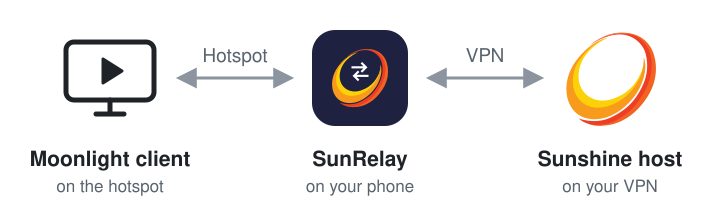

# SunRelay

Stream from a [Sunshine](https://github.com/SunshineStream/Sunshine) host to devices on your phone's hotspot, with the phone relaying the stream over your VPN.

<picture>
  <source media="(prefers-color-scheme: dark)" srcset="docs/how-it-works-dark.svg">
  
</picture>

## How it works

- Forwards Sunshine's TCP and UDP ports from the hotspot to the host over the VPN.
- Advertises itself over mDNS, so Moonlight finds it without typing an address.
- Pairs Moonlight from the phone: enter the PIN in SunRelay, using your Sunshine login.
- Works with Wi-Fi, USB and Bluetooth tethering.
- Finds your host through the Tailscale, ZeroTier, NetBird or Headscale API, or by scanning any other VPN.

## Requirements

- Android 12 or later
- A Sunshine host reachable over a VPN

## License

[MIT](LICENSE), except for third-party names and logos (see below).

## Trademarks

Sunshine, Moonlight, Tailscale, ZeroTier, NetBird and Headscale are trademarks of their respective owners. SunRelay is an independent project and is not affiliated with, sponsored by or endorsed by any of them.

The app icon and the diagram above use the Sunshine logo, licensed under GPL-3.0 by the Sunshine authors.
